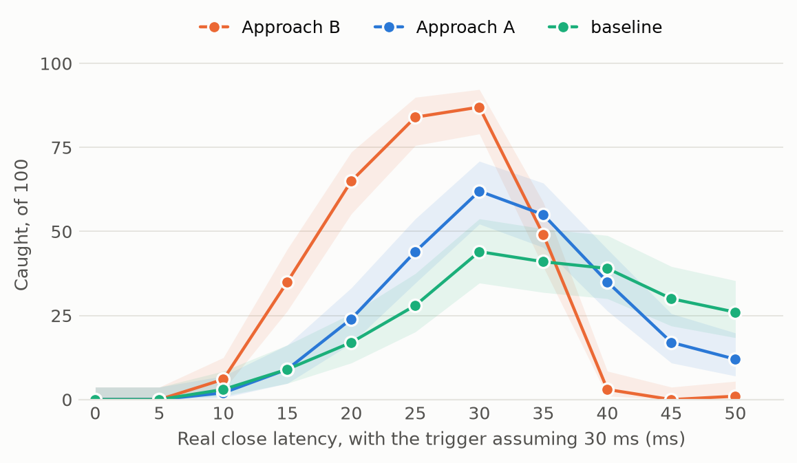
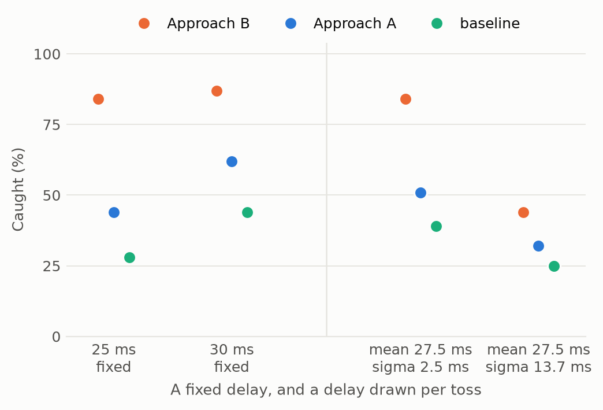
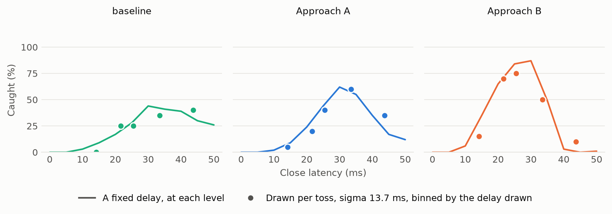
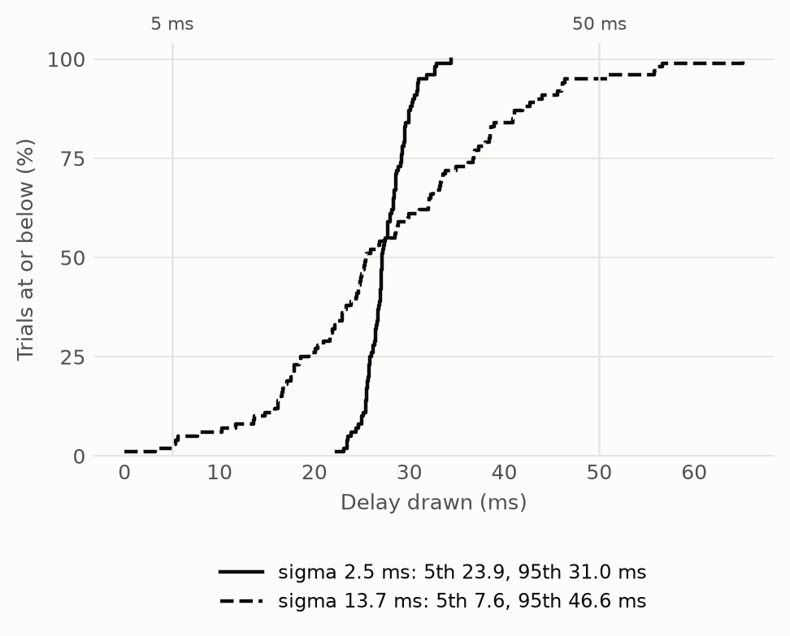
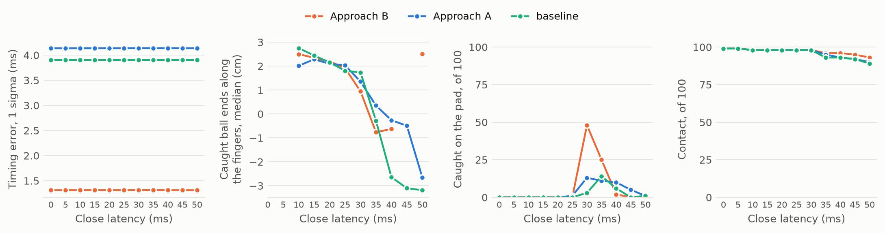

# The Gripper's Closing Delay

How the baseline, Approach A and Approach B hold up as the delay between deciding to close and the
fingers starting to move changes — swept as a constant at eleven levels, and drawn per toss from a
Gaussian at two spreads.

**Run 2026-11-06.** `HEADLESS=1 python robustness.py extend`, 3,000 trials for these cells, within the
9,300-trial sweep in `results/robustness.csv`. The generated tables are in `results/robustness.md`;
this document is the interpretation. Figures are in `results/figures/`, drawn by `python figures.py`.
Every number here is in a table there.

The tables are also drawn as images in `results/tables/`, by `python tables.py`, numbered in the order
they appear in `results/robustness.md`. The ones for this work are:

| Image | Table |
|---|---|
| `05-close-latency-with-the-trigger-assuming-30-ms.png` | The eleven constant levels |
| `06-close-latency-drawn-per-toss-with-the-trigger-still-assuming-30-ms.png` | The two drawn cells |
| `07-what-the-sampler-drew.png` | The sampler audit |
| `08-a-drawn-delay-against-the-fixed-level-nearest-it.png` | Drawn tosses binned against the nearest fixed level |
| `14-` to `26-` | Every metric, one image per close-latency cell |

**The figures carry no numbers on their lines.** Every count is in a table — here, and generated in
`results/robustness.md` — so nothing is readable only from a picture, and the baseline's colour, which
sits below 3:1 against the surface, never has to carry identity on its own.

Each cell is 100 tosses at the nominal noise (σ_p = 2 mm, σ lateral = 0.04 m/s, σ vertical = 0.02 m/s).
**Trial *n* is the same toss, the same sensor noise and the same gripper delay under all three
approaches**, so every comparison is paired and uses McNemar's exact test. The trigger always assumes
30 ms, at every level and in both drawn cells: a real gripper cannot know what it is about to draw.

---

## 1. The headline

**The timing of the close matters more than any other factor in the study, and Approach B is the most
sensitive of the three to getting it wrong.** B is much the best approach while the delay is within
about 5 ms of what the trigger assumes, and the worst once it is more than 5 ms late.

| real latency | baseline | A | B | B against A: only B / only A, p |
|---|---|---|---|---|
| 0 ms | 0 | 0 | 0 | 0 / 0, p = 1 |
| 5 ms | 0 | 0 | 0 | 0 / 0, p = 1 |
| 10 ms | 3 | 2 | 6 | 4 / 0, p = 0.12 |
| 15 ms | 9 | 9 | **35** | 26 / 0, p = 3e-08 |
| 20 ms | 17 | 24 | **65** | 43 / 2, p = 5.9e-11 |
| 25 ms | 28 | 44 | **84** | 41 / 1, p = 2e-11 |
| **30 ms (assumed)** | 44 | 62 | **87** | 25 / 0, p = 6e-08 |
| 35 ms | 41 | 55 | 49 | 18 / 24, p = 0.44 |
| 40 ms | 39 | 35 | **3** | 1 / 33, p = 4.1e-09 |
| 45 ms | 30 | 17 | **0** | 0 / 17, p = 1.5e-05 |
| 50 ms | 26 | 12 | **1** | 0 / 11, p = 0.00098 |

## 2. Findings

### 1. B's collapse is a cliff, and it is between 35 and 40 ms

B falls 46 points — from 49 to 3 — across one 5 ms step. The previous sweep had levels at 30 and 50 ms
only, so it could report that B "keeps 1 of 100 at 50 ms" but could not say whether that was a cliff or
a slope. It is a cliff, and it is 10 ms earlier than the old sweep's evidence suggested.

The crossover where A overtakes B is at about **37 ms**: at 35 ms they are statistically tied
(18 only B / 24 only A, p = 0.44), and by 40 ms A wins decisively (1 / 33, p = 4e-9). The old report's
"the one cell where B does clearly worse than A" is really the tail of a crossover that starts 13 ms
earlier.

### 2. B's tolerance is sharply asymmetric: early is survivable, late is fatal

Closing 10 ms early still catches 65 of 100; closing 10 ms late catches 3. The same asymmetry holds for
every approach but is most extreme for B, whose peak is the tallest and narrowest. Read off the half
maxima, B holds above half its peak from about 16 to 36 ms — a **19 ms window** — against the baseline's
22 ms to beyond 50 ms.

Relative to the 30 ms the trigger assumes, that is **about 14 ms of early tolerance against 6 ms of
late**. B is the best of the three at every level from 10 to 30 ms, tied with A at 35, and the worst
from 40 ms on.

### 3. Where the ball ends says why

`end_fingers`, the median distance from the pinch point to the caught ball along the fingers, falls
steadily as the delay grows and **goes negative past 35 ms** (B: 1.92 cm at 25 ms, 0.95 at 30, −0.76 at
35, −0.63 at 40). A negative value means the ball ends on the far side of the pinch point: it has passed
the pads before they arrived.

This is direct evidence for the mechanism the earlier report could only hypothesise. B puts the pads
exactly where the ball is going to be, so fingers that arrive late let the ball straight through. The
baseline and A place the ball less well, so a late finger still clips it and slows it — which is why
they keep catching 26 and 12 at 50 ms while B keeps 1.

**Being accurate is what makes B fragile to bad timing.** That is worth stating plainly in the paper:
it is a cost of the method, not a bug in it.

### 4. Everything below 10 ms is a wipeout for all three

At 0 and 5 ms nothing is caught by anyone, while contact stays at 99 of 100. The fingers are closed
before the ball arrives and it bounces off them. No approach can recover from a trigger that is 25 ms
early, because none of them re-opens the gripper.

### 5. The delay touches only the gripper, which the record confirms

Predicted miss (1.7 / 0.1 cm for A / B), timing error (4.1 / 1.3 ms), tosses that stayed on the
baseline's plan (19 / 13) and failed solves per trial (1.6) are **identical at every one of the eleven
levels and in both drawn cells**. Latency gates the finger command and nothing else: it never reaches
the estimator or the planner. That is a useful internal check on the experiment as well as a result.

---

## 3. A delay drawn per toss

Two spreads, both centred on 27.5 ms — the midpoint of the 5 and 50 ms ends of the constant sweep.

| cell | baseline | A | B | B against A |
|---|---|---|---|---|
| 25 ms fixed | 28 | 44 | 84 | 41 / 1, p = 2e-11 |
| 30 ms fixed | 44 | 62 | 87 | 25 / 0, p = 6e-08 |
| drawn, σ = 2.5 ms | 39 | 51 | **84** | 34 / 1, p = 2.1e-09 |
| drawn, σ = 13.7 ms | 25 | 32 | **44** | 23 / 11, p = 0.058 |

### 6. A drawn delay is exactly the fixed curve, sampled — jitter is not its own failure mode

This is the main result of the drawn cells, and it is a clean negative. Two independent tests agree:

**Rate prediction.** Take the fixed-delay curve and average it over the delays each cell actually drew.
Predicted against actual:

| cell | baseline | A | B |
|---|---|---|---|
| σ = 2.5 ms | 36% → 39% | 52% → 51% | 84% → 84% |
| σ = 13.7 ms | 27% → 25% | 33% → 32% | 47% → 44% |

Every approach, both spreads, within 3 points.

**Per-trial pairing, with no interpolation at all.** Where a drawn delay landed within 1.25 ms of a
swept level, that trial is the same toss, the same sensor noise and effectively the same gripper as that
trial at the fixed level, so the two outcomes should agree if only the delay drawn matters:

| cell | baseline | A | B |
|---|---|---|---|
| σ = 2.5 ms | 45/47 | 45/47 | **47/47** |
| σ = 13.7 ms | **43/43** | **43/43** | **43/43** |

At the wide spread the agreement is perfect for all three approaches. **Variability in the gripper's
delay costs nothing beyond the delay it happens to draw.** A latency distribution can therefore be
evaluated from the constant-latency curve without simulating it — which is a cheap and useful thing for
the paper to be able to say.

The counts behind that figure. Each drawn cell's 100 tosses are sorted by the delay they actually drew
and split into five groups of 20, against the fixed level nearest each group:

| spread | delay drawn (ms) | tosses | caught, baseline / A / B | nearest fixed level | caught of 100 there |
|---|---|---|---|---|---|
| σ = 2.5 ms | 22.3 to 25.7 | 20 | 8 (40%) / 8 (40%) / 18 (90%) | 25 ms | 28 / 44 / 84 |
| σ = 2.5 ms | 25.7 to 26.9 | 20 | 8 (40%) / 8 (40%) / 17 (85%) | 25 ms | 28 / 44 / 84 |
| σ = 2.5 ms | 26.9 to 27.9 | 20 | 6 (30%) / 9 (45%) / 16 (80%) | 25 ms | 28 / 44 / 84 |
| σ = 2.5 ms | 27.9 to 29.5 | 20 | 5 (25%) / 13 (65%) / 16 (80%) | 30 ms | 44 / 62 / 87 |
| σ = 2.5 ms | 29.5 to 34.4 | 20 | 12 (60%) / 13 (65%) / 17 (85%) | 30 ms | 44 / 62 / 87 |
| σ = 13.7 ms | 0.0 to 17.5 | 20 | 0 (0%) / 1 (5%) / 3 (15%) | 15 ms | 9 / 9 / 35 |
| σ = 13.7 ms | 17.8 to 24.4 | 20 | 5 (25%) / 4 (20%) / 14 (70%) | 20 ms | 17 / 24 / 65 |
| σ = 13.7 ms | 24.4 to 29.9 | 20 | 5 (25%) / 8 (40%) / 15 (75%) | 25 ms | 28 / 44 / 84 |
| σ = 13.7 ms | 29.9 to 38.4 | 20 | 7 (35%) / 12 (60%) / 10 (50%) | 35 ms | 41 / 55 / 49 |
| σ = 13.7 ms | 38.5 to 65.1 | 20 | 8 (40%) / 7 (35%) / 2 (10%) | 45 ms | 30 / 17 / 0 |

Read across each row: a group of drawn tosses catches at about the rate the fixed level nearest it does.
B drawing 17.8 to 24.4 ms catches 70% against 65% at a fixed 20 ms; drawing 38.5 ms or more it catches
10% against 0% at a fixed 45 ms. The bins are wide, so they smooth the cliff — which is why the paired
per-trial test above, where a draw landed within 1.25 ms of a level, is the stronger evidence.

### 7. What the spread costs, and who it costs most

Wide jitter around a 27.5 ms mean roughly **halves B**, from 87 at a fixed 30 ms to 44, losing 43 tosses
and gaining none (0 only drawn / 43 only fixed, p = 2.3e-13). It is not that B is badly centred: against
the 25 ms fixed cell the result is the same, 0 / 40, p = 1.8e-12.

Relative to each approach's own best, the wide spread costs B 43 points, A 30 and the baseline 19 — the
ordering predicted by finding 2, since the approach with the narrowest peak loses most when the delay
wanders off it. **B is still the best of the three under wide jitter** (44 against 32 and 25), but the
gap narrows to the edge of significance (23 / 11, p = 0.058) from 25 / 0 at a fixed 30 ms.

At σ = 2.5 ms B is essentially untouched: 84 against 87, and 0 only drawn / 3 only fixed (p = 0.25)
against the fixed 30 ms cell. **A gripper that repeats to a couple of milliseconds costs nothing worth
reporting; one that wanders by ten costs half the catches.**

### 8. The sampler drew what it was asked for

| cell | mean asked | σ asked | drawn mean | drawn σ | drawn 5th | drawn 95th | clipped at 0 |
|---|---|---|---|---|---|---|---|
| σ = 2.5 ms | 27.5 | 2.5 | 27.6 | 2.3 | 23.9 | 31.0 | 0 of 100 |
| σ = 13.7 ms | 27.5 | 13.7 | 27.9 | 12.4 | 7.6 | 46.6 | 1 of 100 |

σ = 13.7 ms is the spread that puts the 5th percentile on 5 ms and the 95th on 50 ms,
(0.050 − 0.005) / (2 × 1.6449). The drawn 5th and 95th come out at 7.6 and 46.6 ms rather than 5 and 50:
that is sampling error in 100 draws, not a sampler fault — the realised mean and σ are within 0.4 and
1.3 ms of what was asked, and the test suite checks the percentiles over 20,000 draws. One draw of the
100 fell below zero and was clipped, against the 2.2% expected.

---

## 4. Which σ the paper should quote

**σ = 13.7 ms, with σ = 2.5 ms beside it.** The wide one is the interesting cell: it is the only
condition in the whole study that pulls B down to the baseline's level, and it makes the point of
finding 6 — that a distribution of delays is predictable from the constant curve — on a spread big
enough for the prediction to be a real test. The narrow one is worth a sentence as the contrast: a
gripper repeatable to a couple of milliseconds needs no modelling at all.

Neither is a measurement of a real gripper. **A real WSG's latency distribution would have to be
measured**, and finding 6 says exactly what to do with it once it is: average the constant-latency curve
over it, and no further simulation is needed.

---

## 5. Secondary metrics

Every metric on `planning/metrics.md`'s list, for all three approaches at each of the thirteen cells, is
in `results/robustness.md` under "Every metric at each close latency".

## 6. Caveats

- **The trigger always assumes 30 ms.** Sweeping the real delay with the trigger told each value would
  change nothing, which is why it is not done; but it means every level other than 30 ms is a *wrong*
  assumption, not a different gripper.
- **The nominal cell and the moving start were chosen after seeing results**, as `results/robustness.md`
  already records. These latency cells were not: the levels were fixed before the run.
- **Thirteen cells, three approaches, many tests.** The constant sweep's shape is the result; individual
  p-values within it carry no multiple-comparison correction, so treat a p near 0.05 — such as the
  23 / 11, p = 0.058 at σ = 13.7 ms — as a hint.
- **The 0, 20, 30 and 50 ms levels are rows from the earlier 6,600-trial sweep**, reused rather than
  re-run. They were verified first: across 500 trials compared in two cells, every catch outcome matched,
  with one trial differing in a borderline replan that changes no reported rate.
- **100 trials per cell is ±10 points.** Neighbouring levels differing by a few catches mean little; the
  46-point step from 35 to 40 ms does not.
